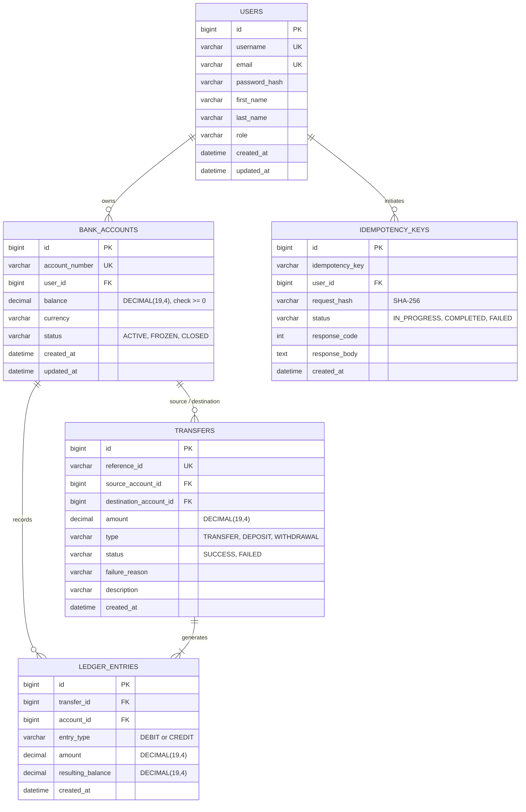

# Mini Banking System • Core Banking & Ledger Engine

[](https://openjdk.org/)
[](https://spring.io/projects/spring-boot)
[](https://spring.io/projects/spring-security)
[](https://www.mysql.com/)
[](https://react.dev/)
[](https://vitejs.dev/)
[-brightgreen?style=for-the-badge&logo=junit5&logoColor=white)](https://github.com/Aman5ingh19/Mini-Banking-System)

> **Notice**: Mini Banking System is an educational banking and financial transaction engine designed to demonstrate database transaction atomicity, pessimistic concurrency control, cryptographic idempotency, and double-entry bookkeeping. All funds and accounts are strictly simulated demo assets.

---

## 📖 About The Project

The **Mini Banking System** is a modern, secure full-stack banking and transaction processing application designed to demonstrate how real-world financial backends guarantee transactional consistency, auditability, and concurrency safety. It provides an end-to-end simulation of customer demo account provisioning, peer-to-peer simulated money transfers, cryptographic request deduplication, and immutable double-entry bookkeeping.

### 🛠️ Built With

- **Backend Framework**: [Java 21 (LTS)](https://openjdk.org/) & [Spring Boot 3.3.4](https://spring.io/projects/spring-boot) (Clean Layered Architecture)
- **Security & Authorization**: [Spring Security 6](https://spring.io/projects/spring-security) with stateless **JWT (JJWT 0.12.6)** authentication, **BCrypt (strength 12)** password hashing, and server-side sender identity derivation
- **Persistence & ORM**: **Spring Data JPA** & **Hibernate 6.5** with `BigDecimal` precision mapping (`DECIMAL(19, 4)`)
- **Database Engine**: [MySQL 8.0](https://www.mysql.com/) with InnoDB row-level locks (plus an in-memory H2 MySQL-compatibility profile for zero-config local development)
- **API Documentation & Testing Console**: [Springdoc OpenAPI 2.6.0](https://springdoc.org/) (Interactive Swagger UI 3.0)
- **Frontend Architecture**: [React 19](https://react.dev/) & [Vite 6](https://vitejs.dev/) Single Page Application with Axios JWT request interceptors
- **User Interface & Styling**: Tailored **Vanilla CSS Design System** featuring a dark-mode glassmorphism aesthetic, interactive account masking, and responsive layout
- **Validation & Error Handling**: **Jakarta Bean Validation** (`@Valid`, `@Positive`, `@NotBlank`) with RFC 7807 problem details
- **Automated Testing**: **JUnit 5**, **Mockito**, and **Spring Boot Test** with multi-threaded concurrency tests for race condition and deadlock validation

---

## 🏛️ System Architecture

The **Mini Banking System** implements **Clean Layered Architecture**, separating presentation, authorization, business rules, persistence, and database locking.

```
┌────────────────────────────────────────────────────────────────────────┐
│                        Presentation Tier (React 19)                    │
│   - Glassmorphic UI & Dark Theme     - Masked Bank Account Display     │
│   - Transfer & Deposit Modals        - Axios JWT Interceptor & Routing │
└───────────────────────────────────┬────────────────────────────────────┘
                                    │ HTTPS / REST / Bearer JWT
                                    ▼
┌────────────────────────────────────────────────────────────────────────┐
│                      Spring Boot 3 Application Layer                   │
│                                                                        │
│  ┌──────────────────────────────────────────────────────────────────┐  │
│  │                     Security & Filter Chain                      │  │
│  │   - CORS Filter   - JwtAuthenticationFilter  - ExceptionAdvice   │  │
│  └────────────────────────────────┬─────────────────────────────────┘  │
│                                   │ Authenticated Principal Context    │
│  ┌────────────────────────────────▼─────────────────────────────────┐  │
│  │                   REST Controllers & DTO Validation              │  │
│  │   - AuthController   - AccountController   - TransferController  │  │
│  │   - AdminController  - TransactionController                     │  │
│  └────────────────────────────────┬─────────────────────────────────┘  │
│                                   │ Validated Domain Commands          │
│  ┌────────────────────────────────▼─────────────────────────────────┐  │
│  │                      Service & Domain Layer                      │  │
│  │   - TransferService (@Transactional, Pessimistic Lock, Ordering) │  │
│  │   - IdempotencyService (SHA-256 Deduplication & Replay)          │  │
│  │   - AccountService (Balance query, Recipient search, Masking)    │  │
│  │   - LedgerService (Double-entry accounting records)              │  │
│  │   - AuthService (BCrypt encoding, JWT issuance, Demo Seeding)    │  │
│  └────────────────────────────────┬─────────────────────────────────┘  │
│                                   │ Entity Operations & Row Locks      │
│  ┌────────────────────────────────▼─────────────────────────────────┐  │
│  │               Data Access Layer (Spring Data JPA)                │  │
│  │   - UserRepository              - BankAccountRepository          │  │
│  │   - TransferRepository          - LedgerEntryRepository          │  │
│  │   - IdempotencyKeyRepository    - SELECT ... FOR UPDATE Queries  │  │
│  └────────────────────────────────┬─────────────────────────────────┘  │
└───────────────────────────────────┼────────────────────────────────────┘
                                    │ SQL (InnoDB Row Locks)
                                    ▼
┌────────────────────────────────────────────────────────────────────────┐
│                        Database Tier (MySQL 8.0)                       │
│   - ACID Transactions             - Row-Level Locking (Pessimistic)    │
│   - DECIMAL(19,4) Precision       - Unique Constraints & Foreign Keys  │
└────────────────────────────────────────────────────────────────────────┘
```

---

## 🗄️ Relational Database Schema & ER Diagram

All monetary values are modeled using MySQL `DECIMAL(19, 4)` and Java `java.math.BigDecimal` to eliminate IEEE-754 floating-point rounding errors.



---

## ⚙️ Core Engineering Design Decisions

### 1. Concurrency Control: Pessimistic vs. Optimistic Locking
| Characteristic | Optimistic Locking (`@Version`) | Pessimistic Write Locking (`FOR UPDATE`) — **Implemented** |
|---|---|---|
| **Collision Behavior** | Throws `OptimisticLockException` on commit | Queues transactions at the database row lock |
| **High Contention** | Causes retry storms and failed user transfers | Guaranteed sequential execution without retries |
| **Suitability** | Low-contention CMS / read-heavy apps | Financial balances, high-frequency account transfers |

```java
// BankAccountRepository.java
@Lock(LockModeType.PESSIMISTIC_WRITE)
@Query("SELECT b FROM BankAccount b WHERE b.id = :id")
Optional<BankAccount> findByIdForUpdate(@Param("id") Long id);
```

### 2. Deadlock Elimination via Deterministic Ordering
When two bidirectional transfers happen concurrently ($A \to B$ and $B \to A$):
- **Naive approach**: Thread 1 locks $A$ and requests $B$; Thread 2 locks $B$ and requests $A$. The database triggers a deadlock exception (`40001`).
- **Our Solution**: Always acquire locks in order of increasing numerical account ID:
$$\text{firstLockId} = \min(\text{ID}_A, \text{ID}_B), \quad \text{secondLockId} = \max(\text{ID}_A, \text{ID}_B)$$
Both threads request the lower ID first, turning potential deadlocks into safe, serialized executions.

### 3. Request Idempotency & Replay Defense
To defend against network timeouts and duplicate submissions:
1. Client generates a unique UUID `Idempotency-Key` header.
2. The service computes a SHA-256 hash of `recipient + amount + memo`.
3. If an existing entry with status `COMPLETED` is found:
   - Validates that the payload hash matches (rejecting parameter tampering with `422/409`).
   - Replays the cached receipt directly without re-executing balance mutations.
4. Uses `Propagation.REQUIRES_NEW` to commit the `IN_PROGRESS` reservation independently of the outer transfer transaction.

### 4. Double-Entry Accounting Invariant
For every completed money movement, two ledger entries are written:
$$\text{DEBIT}_{\text{sender}} + \text{CREDIT}_{\text{receiver}} = 0$$
Each ledger entry records the point-in-time `resulting_balance`, creating an immutable audit trail.

---

## 🔒 Security & Defensive Engineering

- **Stateless JWT Authorization**: Signed via HMAC-SHA256 (`HS256`), carrying user claims (`userId`, `role`, `username`).
- **Server-Side Sender Derivation**: The client never supplies the sender's account ID. The backend resolves the sender strictly from the authenticated JWT `SecurityContextHolder`.
- **Role-Based Access Control (RBAC)**:
  - `ROLE_USER`: Standard banking operations (transfer, own ledger view).
  - `ROLE_ADMIN`: Administrative simulated deposits/withdrawals (`/api/admin/**`). Regular users receive `HTTP 403 Forbidden`.
- **Data Protection & Masking**: Account numbers are masked (`•••• •••• 8574`) across responses and logs to mitigate screen scraping and data leakage.
- **Centralized Exception Sanitization**: Global `@RestControllerAdvice` suppresses raw stack traces and internal exceptions, producing RFC 7807 problem details.

---

## 📡 REST API Reference

All protected endpoints require `Authorization: Bearer <JWT>` header.

| Method | Endpoint | Auth | Role | Description |
|---|---|---|---|---|
| `POST` | `/api/auth/register` | No | Public | Register new profile & allocate $1,000 demo funds |
| `POST` | `/api/auth/login` | No | Public | Authenticate user & issue JWT token |
| `GET` | `/api/accounts/me` | Yes | `USER`, `ADMIN` | Fetch authenticated user's account details |
| `GET` | `/api/accounts/{id}/balance` | Yes | Owner/Admin | Fetch account balance with strict ownership check |
| `GET` | `/api/accounts/search` | Yes | `USER`, `ADMIN` | Safe recipient lookup by account number or name |
| `POST` | `/api/transfers` | Yes | `USER`, `ADMIN` | Execute atomic transfer (`Idempotency-Key` header) |
| `GET` | `/api/transfers/{refId}` | Yes | Involved/Admin | Fetch transfer receipt by reference ID |
| `GET` | `/api/transactions` | Yes | `USER`, `ADMIN` | Paginated transaction ledger with date/type filter |
| `POST` | `/api/admin/accounts/{id}/deposits` | Yes | `ADMIN` | Privileged administrative simulated credit |
| `POST` | `/api/admin/accounts/{id}/withdrawals` | Yes | `ADMIN` | Privileged administrative simulated debit |
| `GET` | `/swagger-ui/index.html` | No | Public | Interactive OpenAPI 3.0 / Swagger UI |

---

## 🧪 Comprehensive Automated Testing

The suite uses **JUnit 5, MockMvc, and Spring Boot Test** against a real relational database environment (14 passed, 0 failures):

```bash
cd backend
mvn clean test
```

### Key Test Validations
| Test Class | Focus Area | Verified Behavior |
|---|---|---|
| `ConcurrencyTransferTest` | Race Conditions | 2 concurrent threads debit $80 from $100 simultaneously; exactly 1 succeeds, remaining balance is strictly $20.00. |
| `ConcurrencyTransferTest` | Deadlocks | Bidirectional simultaneous transfers ($A \to B$ and $B \to A$) execute concurrently without deadlocking. |
| `TransferServiceIntegrationTest` | Double-Entry Accounting | Validates zero-sum conservation invariant and dual `DEBIT`/`CREDIT` ledger creation. |
| `TransferServiceIntegrationTest` | Idempotency Replay | Repeated requests with identical idempotency keys return the cached receipt without debiting twice. |
| `TransferServiceIntegrationTest` | Idempotency Tampering | Reusing a key with modified payload is rejected with `DuplicateIdempotencyKeyException`. |
| `TransferServiceIntegrationTest` | Atomicity & Rollback | Insufficient balance throws exception and rolls back both account balances. |
| `SecurityAndAuthIntegrationTest` | Authorization | Verifies 401 on unauthenticated access, 403 on inspecting another user's balance, and 403 on unauthorized admin deposits. |

---

## 🚀 Quickstart & Execution Guide

### Option 1: Instant Dev Mode (Zero Database Installation)
The default `dev` profile uses an in-memory database with MySQL 8 compatibility mode:

1. **Start Spring Boot Backend** (Port 8080):
   ```bash
   cd backend
   mvn spring-boot:run
   ```
2. **Start React Frontend** (Port 3000):
   ```bash
   cd frontend
   npm install
   npm run dev
   ```
3. Open `http://localhost:3000` in your browser.

### Option 2: Production Setup with MySQL 8.0 via Docker Compose
1. **Start MySQL Container**:
   ```bash
   docker compose up -d
   ```
2. **Start Backend with MySQL Profile**:
   ```bash
   cd backend
   mvn spring-boot:run -Dspring-boot.run.profiles=mysql
   ```

---

## 👥 Seeded Demo Accounts (1-Click Login)

The system automatically initializes 3 demo profiles:

| Account | Username | Password | Role | Simulated Balance |
|---|---|---|---|---|
| **Alice (Customer)** | `alice_demo` | `Password123!` | `ROLE_USER` | **$1,000.00** |
| **Bob (Customer)** | `bob_demo` | `Password123!` | `ROLE_USER` | **$1,000.00** |
| **System Admin** | `admin_demo` | `Admin123!` | `ROLE_ADMIN` | **$10,000.00** |

---

## 🛠️ Tech Stack & Dependencies

- **Language & Runtime**: Java 21 (LTS)
- **Framework**: Spring Boot 3.3.4
- **Persistence**: Spring Data JPA, Hibernate ORM 6.5
- **Security**: Spring Security 6, JJWT 0.12.6, BCrypt
- **API Documentation**: Springdoc OpenAPI 2.6.0 (Swagger UI 3.0)
- **Database**: MySQL 8.0 / H2 (MySQL Mode)
- **Frontend**: React 19, Vite 6, Axios, Lucide Icons, Vanilla CSS Design System
- **Testing**: JUnit 5, Mockito, Spring Boot Test, MockMvc

---

## 📄 License
This project is open-source under the MIT License for educational and portfolio demonstration purposes.
